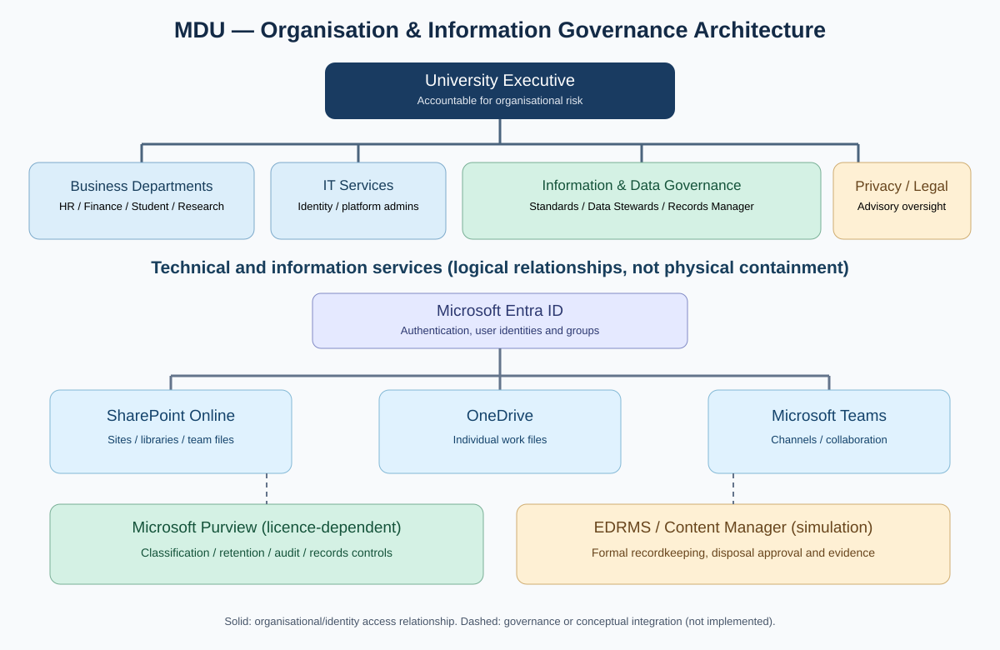

# Enterprise Information & Data Governance | University Microsoft 365 Lab

> **Portfolio project / fictional case study** — Melbourne Digital University (MDU). Not affiliated with Swinburne University. This repository is a **starter implementation kit**, not evidence that a Microsoft 365 tenant or Content Manager instance has already been configured.

## The business problem
A fictional Australian university needs consistent information ownership, SharePoint site and library structures, Microsoft Teams and OneDrive sharing controls, classification, records retention, data access approvals, business glossary management, service-request handling, and periodic risk reviews.

## Architecture

**Identity and access:** Microsoft Entra ID authenticates users and supplies identities/groups. **Collaboration:** SharePoint stores team/channel files and departmental documents; OneDrive stores individuals' work files; Teams provides collaboration. **Governance:** policies and designated Data Owners/Stewards guide access decisions; Microsoft Purview may apply classification, retention, audit and compliance controls depending on licensing. **Records:** an EDRMS / Content Manager integration is a *design-only simulation*, not an implemented connector.

## What is inside
| Folder | Purpose |
|---|---|
| `architecture/` | Organisational structure, logical architecture and data lifecycle diagrams |
| `docs/` | Governance framework, control standards, implementation runbook, glossary and interview notes |
| `templates/` | Ready-to-adapt CSV registers for assets, metadata, approvals, risks, tickets, reviews and retention |
| `sample-data/` | Fictional, non-sensitive example records and scenarios |
| `tests/` | Acceptance tests and reproducible validation steps |
| `evidence/` | Screenshot checklist and blank evidence folders; no fabricated results |
| `automation/` | Optional PowerShell assessment script (read-only by default) |
| `manual/` | Full beginner PDF manual |

## How to complete and showcase the lab
1. Read `manual/MDU_Information_Data_Governance_Complete_Beginner_Manual.pdf` and `docs/01-organisation-and-architecture.md`.
2. Set up a legally obtained Microsoft 365 test tenant with appropriate licences. Do not use a university/production tenant without permission.
3. Work through `docs/02-implementation-runbook.md` and `tests/acceptance-tests.md`.
4. Replace placeholders in the registers with **sanitised evidence from your own lab** and save screenshots to `evidence/screenshots/`.
5. Update `STATUS.md` and the implementation results table below. Never claim design-only features were deployed.

## Implementation status
| Workstream | Status | Proof |
|---|---|---|
| Organisation, ownership and architecture | Designed | `architecture/`, `docs/` |
| Governance policy and standards | Drafted | `docs/`, `templates/` |
| SharePoint/Teams/OneDrive lab | Not yet deployed | `evidence/` |
| Entra ID test groups and access | Not yet deployed | `evidence/` |
| Purview retention/classification | Licence-dependent; not yet deployed | `evidence/` |
| Data Steward approvals | Template only | `templates/access-requests.csv` |
| Content Manager EDRMS | Conceptual simulation only | `docs/05-edrms-content-manager-simulation.md` |
| Reviews, tickets and risk management | Scenarios/templates only | `tests/`, `templates/` |

## Skills demonstrated by the repository
Information architecture; Microsoft 365 governance design; site/library/metadata standards; RBAC and least privilege; data stewardship; access approval process; business glossary; information lifecycle; retention/disposal decision controls; records management concepts; service management; audit planning; risk registers; stakeholder guidance.

**Accuracy:** The templates are illustrative, not legal advice or a definitive Victorian university retention schedule. Confirm obligations with the organisation's Records Manager, Privacy Officer and current authoritative legislation/disposal authorities.

## Privacy and security
All people, IDs and cases are fictitious. Do not commit credentials, tenant IDs, access tokens, real employee/student data, or unredacted screenshots. See `SECURITY.md`.

## Interview summary
"I designed a fictional university-wide information governance framework covering Microsoft 365 collaboration, data ownership, permissions, metadata, access approvals, retention and service processes. I separated technical controls from business approvals and documented a simulated Content Manager integration. My repository contains architecture, policies, testing and evidence templates; I distinguish the design from any controls I have actually tested in a tenant."
