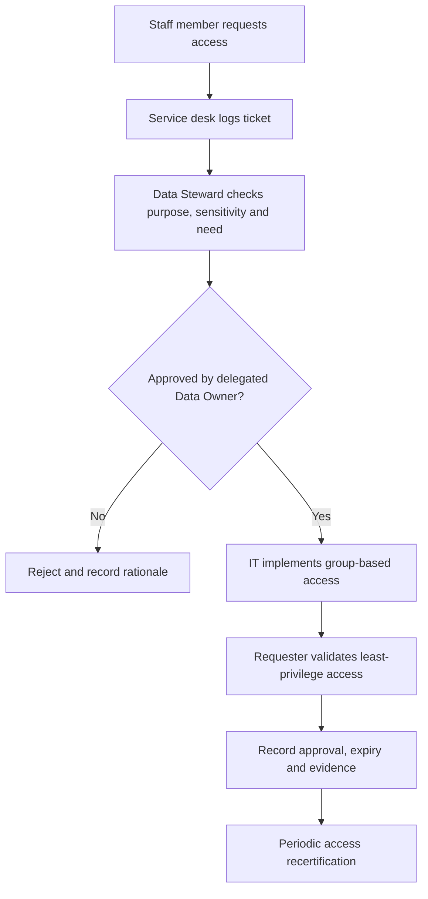

# Access request and Data Steward decision flow

**Separation of duties:** Data Owner is accountable for authorisation; Data Steward administers governance and may recommend approval; IT applies permissions. Actual approval delegation must be documented.
