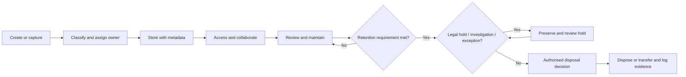

# Information lifecycle (conceptual process)

**Note:** The flow is a proposed policy process, not an automatically functioning workflow. A retention label alone does not guarantee legally authorised destruction.
